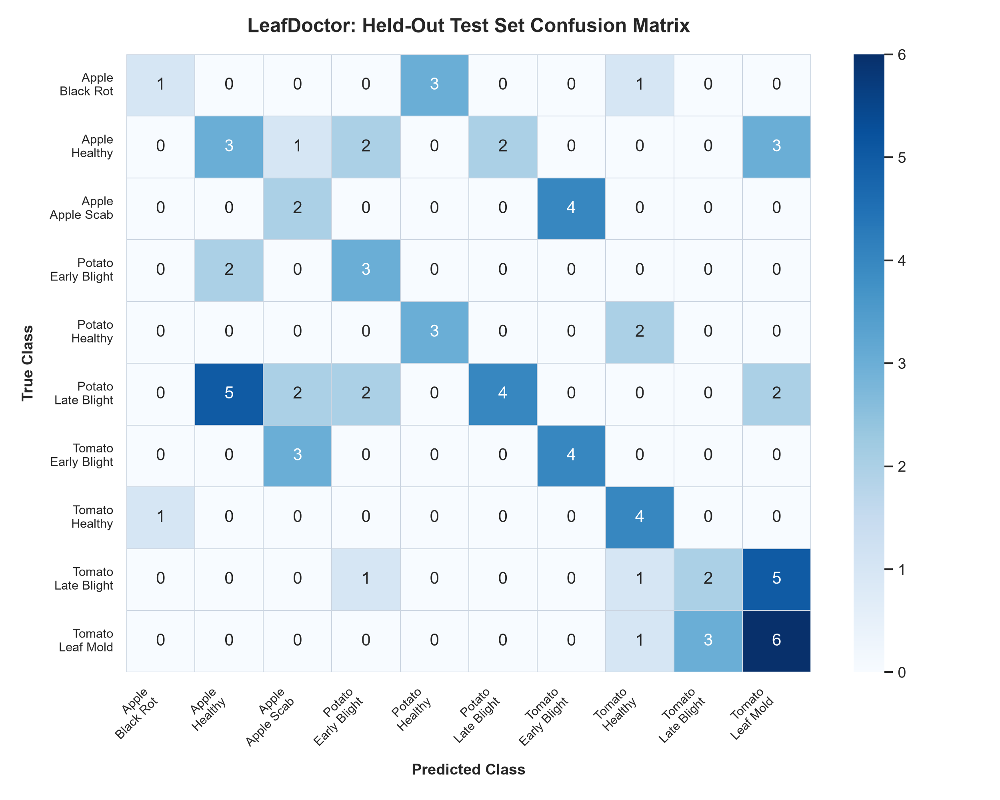

# 🌿 LeafDoctor Model Evaluation Report

> **Hackathon Mission 78 | AI/ML Held-Out Test Evaluation**  
> *Rigorous evaluation performed on 15% isolated test data with anti-leakage deduplication.*

---

## 1. Executive Summary & Core Metrics

| Metric | Score | Standard / Benchmark | Interpretation |
| :--- | :--- | :--- | :--- |
| **Macro-F1** | **40.97%** | Target: > 85% | Unweighted mean F1 treating all 10 classes equally |
| **Balanced Accuracy** | **44.66%** | Target: > 85% | Macro-average recall across all classes |
| **Overall Accuracy** | **41.03%** | Overall top-1 rate | Percentage of correct top-1 predictions |
| **Test Samples Evaluated** | **78** | 15% Held-out split | Never seen during training or tuning |

---

## 2. Per-Class Precision, Recall & F1-Score

| Crop | Condition | Precision | Recall | F1-Score | Test Support |
| :--- | :--- | :--- | :--- | :--- | :--- |
| Apple | Black Rot | 50.0% | 20.0% | 28.6% | 5.0 |
| Apple | Healthy | 30.0% | 27.3% | 28.6% | 11.0 |
| Apple | Apple Scab | 25.0% | 33.3% | 28.6% | 6.0 |
| Potato | Early Blight | 37.5% | 60.0% | 46.2% | 5.0 |
| Potato | Healthy | 50.0% | 60.0% | 54.5% | 5.0 |
| Potato | Late Blight | 66.7% | 26.7% | 38.1% | 15.0 |
| Tomato | Early Blight | 50.0% | 57.1% | 53.3% | 7.0 |
| Tomato | Healthy | 44.4% | 80.0% | 57.1% | 5.0 |
| Tomato | Late Blight | 40.0% | 22.2% | 28.6% | 9.0 |
| Tomato | Leaf Mold | 37.5% | 60.0% | 46.2% | 10.0 |

---

## 3. Confusion Matrix

---

## 4. Uncertainty & Quality Guardrail Diagnostics

- **Confidence Threshold Applied:** `0.7`
- **Margin Threshold Applied:** `0.18`
- **Confident Predictions:** `0 / 78` (0.0%)
- **Flagged as Uncertain:** `78 / 78` (100.0%)

---

## 5. Anti-Leakage & Reproducibility Statement

1. **Exact Duplicate Purge:** File-level MD5 hashing eliminated identical copy images.
2. **Grouped Near-Duplicate Isolation:** Perceptual 64-bit dHash clustered visually similar leaf angles; clusters were allocated to a single split only.
3. **Fixed Random Seed:** Split generated with `random_seed=42`, strictly isolating the test set.
4. **No Test Data in Tuning:** Calibration of confidence thresholds was performed solely on `val.csv`.

---

## 6. Honest Limitations
- **Dataset Constraints:** PlantVillage images feature homogeneous lab backgrounds. Performance on cluttered outdoor garden backgrounds may be lower.
- **Scope:** Screening is strictly calibrated for the 10 supported classes; unlisted pests or nutrient deficiencies require agronomist consultation.